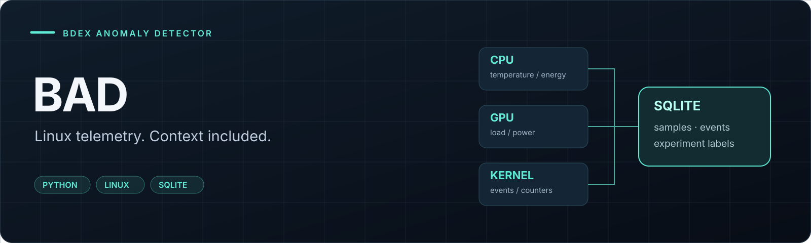

# BAD · Bdex Anomaly Detector

**Build a hardware anomaly dataset that explains what the machine was doing.**

BAD collects Linux hardware telemetry, workload context and fault events into a local SQLite database. It is designed for labelled experiments around cooling, airflow and system instability, with a collector that keeps running when an optional source is unavailable.

`Python 3.10+` · `Linux /proc + /sys` · `SQLite WAL` · `No required third-party packages`

[Start collecting](#quick-start) · [Design](#design) · [Readers](#data-sources) · [Full reference](docs/REFERENCE.md)

> **Current scope:** telemetry collection, fault classification and experiment labels are implemented. Training a learned anomaly detector is a later stage; this repository prepares the data for it.

## What makes the data useful

| Layer | What it records | Why it matters |
| :--- | :--- | :--- |
| **Hardware** | CPU/GPU temperatures, power, utilization and exposed device sensors | Captures the machine's physical response. |
| **Workload context** | CPU/memory pressure, active processes and usage hints | Helps distinguish a demanding workload from an abnormal response. |
| **Fault evidence** | Classified kernel messages and hardware error-counter deltas | Adds evidence beyond temperature thresholds. |
| **Ground truth** | Manually labelled experiment windows | Preserves what was deliberately changed during an experiment. |

## Quick start

From the repository root, using Python 3.10 or later:

```bash
python -m collector.main --doctor
python -m collector.main --scan
python -m collector.main --db data/metrics.db --period 1.0
```

`--doctor` describes the sources this machine exposes. `--scan` classifies errors from the current boot without starting continuous database collection. Reader availability depends on the hardware, drivers and permissions; RAPL energy readings may require elevated access.

Annotate an experiment in a second terminal:

```bash
python -m collector.label start baseline -n "normal cooling, usual workload"
python -m collector.label end
python -m collector.label list
```

For unattended collection, see the [systemd unit](systemd/bad-collector.service). Optional NVIDIA support uses `nvidia-ml-py`; the rest of the collector can run with the standard library.

## Design

Each reader owns one source, discovers it during setup and returns a dictionary of values on each tick. A missing source disables itself; read failures are tracked without bringing down the acquisition loop.

| Decision | Implementation |
| :--- | :--- |
| **Discover sensors by identity** | Resolve hwmon devices by their `name` rather than unstable numeric paths. |
| **Keep labels explicit** | Missing ground truth remains `NULL`; the collector does not guess experiment outcomes. |
| **Handle cumulative counters** | Convert RAPL energy deltas into power, account for wraparound, and reject implausible reset spikes. |
| **Recover current-boot events** | Replay available kernel records and deduplicate them before storage. |
| **Store locally** | A wide time-series table and SQLite WAL suit a single collector without a database server. |

## Data sources

| Source group | Readers |
| :--- | :--- |
| CPU, memory and pressure | `proc`, `psi`, `k10temp`, `rapl` |
| GPU | `nvml` for NVIDIA, `amdgpu` for AMD |
| Board and storage sensors | `gigabyte_wmi`, `nvme`, shared `hwmon` discovery |
| Error evidence | `kmsg`, `errcounters` |
| Workload context | `context` |

The schema separates **samples**, **boots**, **events** and **labels**. Columns evolve with discovered readers; unavailable readings remain missing rather than invented values. See [schema.sql](schema.sql) and the [reader catalogue](docs/REFERENCE.md#-what-each-reader-collects).

## Verification

```bash
python -m unittest discover -s tests -t .
```

The existing suite exercises fake `/proc` and `/sys` trees, sensor discovery, counter wraparound, kernel events, storage and collector failures without requiring the matching hardware.

## Explore the implementation

| Entry point | Responsibility |
| :--- | :--- |
| [`collector/main.py`](collector/main.py) | Acquisition loop and reader lifecycle |
| [`collector/readers/`](collector/readers/) | Source-specific discovery and reads |
| [`collector/errors.py`](collector/errors.py) | Kernel fault classification rules |
| [`collector/storage.py`](collector/storage.py) | SQLite schema evolution, batching, events and labels |
| [`collector/label.py`](collector/label.py) | Experiment annotation CLI |

Coverage is hardware-dependent. Software counters cannot expose every physical failure, and heuristic workload labels need interpretation. The [complete reference](docs/REFERENCE.md) documents measurement limits, experiment protocols and machine-specific coverage.
## 🧪 Experimental protocols

### Identifying the 6 `gigabyte_wmi` probes

The driver does not label them. They therefore stay named by index, and the
mapping is determined experimentally — the rename will happen afterwards through
`ALTER TABLE RENAME COLUMN`, which is no reason to guess now.

1. `stress-ng --cpu $(nproc) --timeout 5m` → the probe that rises fastest and
   falls fastest is on the VRM side;
2. GPU load alone → the probe that follows is on the PCIe/chipset side;
3. machine idle, window open → the probe that follows ambient temperature.

> 📝 To be recorded here once it is done.

### Targeted anomaly families

| Label             | How it is provoked                                   |
|-------------------|------------------------------------------------------|
| `fan_curve_low`   | fan curve lowered in the BIOS                        |
| `airflow_blocked` | air intake grille obstructed                         |
| `oc_unstable`     | OC/undervolt out of margin → WHEA in `events`        |
| `stress_ng`       | synthetic reference load                             |
| `gaming`          | real load                                            |
| `normal`          | everything else                                      |

## 🚨 Error detection

This is the `events` table: a point-in-time event — an MCE lasts a microsecond —
cannot exist in a series sampled at 1 Hz. It needs a channel of its own.

"Every possible error" does not exist as a finite list: a driver may invent a
message tomorrow that no pattern knows about. Coverage therefore rests on **three
stages**, each catching the others' blind spots.

### Stage 1 — Classifying kernel messages

38 rules in `collector/errors.py`, arranged into six families: CPU/memory (MCE,
APEI/GHES, ECC, microcode), stability (panic, oops, lockups, RCU stall, GPF),
memory (OOM), GPU (NVIDIA Xid with code translation, AMD resets and faults, video
ECC), storage (NVMe, ATA, block, FS corruption) and bus (PCIe AER, link, USB,
thermal threshold, power, ACPI, firmware, suspend).

The file is **data, not code**: a pattern, a kind, a severity and a sentence of
explanation. Adding a rule does not require touching the engine.

Two sources, chosen at startup:

| Source            | When                          | Deduplication key      |
|-------------------|-------------------------------|------------------------|
| `/dev/kmsg`       | root (default under systemd)  | sequence number        |
| `journalctl -k -f`| without privileges, if systemd| journald cursor        |

Neither forks per tick: `/dev/kmsg` is a descriptor opened once, `journalctl` a
single process for the daemon's whole life.

> 🔁 **Startup replays the entire buffer of the current boot.** Errors that
> occurred before the collector was launched — at boot, or while the service was
> stopped — are recovered with their original timestamp. The deduplication key
> makes this replay idempotent: restarting three times does not record the same
> MCE three times.

### Stage 2 — The catch-all

Any record the kernel itself marks at priority ≤ 3 (err, crit, alert, emerg) and
that no rule recognises is recorded as `kernel_error` with its raw text. That is
what avoids only detecting the failures you had already imagined.

The trade-off: the kernel emits at "error" priority messages that describe a
normal state (`TDX not supported`, `RAS: Correctable Errors collector
initialized`…). An explicit `BENIGN` list filters them out — without it, every
boot would add the same non-events, and a constant present in 100 % of the rows
teaches a model nothing. It is completed machine by machine, and `--scan` exists
precisely for that.

### Stage 3 — Hardware counters

Independent of the text, and that is what makes them valuable:

- they work **without privileges**, where `/dev/kmsg` requires root;
- they catch what the kernel counts **without necessarily logging it** — a
  corrected PCIe error writes nothing to `dmesg` if the rate limit kicked in, but
  the counter still moves.

| Column                                   | Source                    | What it detects                             |
|------------------------------------------|---------------------------|---------------------------------------------|
| `err_mce`                                | `/proc/interrupts` MCE    | Machine Check counted by the CPU            |
| `err_thermal_irq`                        | `/proc/interrupts` TRM    | thermal threshold crossed ← clogged heatsink |
| `err_threshold_irq`, `err_deferred_irq`  | THR, DFR                  | AMD thresholds and deferred errors          |
| `err_nmi`                                | NMI                       | power supply, RAM, watchdog                 |
| `err_oom_kill`                           | `/proc/vmstat`            | processes killed for lack of memory         |
| `err_ecc_ce`, `err_ecc_ue`               | EDAC                      | corrected / uncorrected memory errors       |
| `err_aer_corr/nonfatal/fatal`            | PCIe AER                  | PCIe link quality                            |
| `err_cpu_throttle`, `err_pkg_throttle`   | `thermal_throttle`        | thermal throttling (Intel)                  |
| `err_gpu_ras`                            | amdgpu RAS               | video memory ECC                            |
| `err_disk_io`                            | `ioerr_cnt`               | SCSI I/O errors                             |
| `err_nvme_state`                         | `/sys/class/nvme/*/state` | controller out of the `live` state          |

Each counter is **both an event and a feature**: its delta per tick becomes a
column of `samples`, and any movement writes a row into `events`. A non-zero value
**at startup** is reported too: a machine already counting 4,000 corrected ECC
errors since boot should say so at the first tick, not wait for the 4,001st.

### Coverage, machine by machine

It is not the same everywhere, and `--doctor` says so — including what is **not**
monitored, which matters as much as the rest: without an EDAC controller, a
corrected memory error leaves no trace anywhere.

Measured on the laptop (Ryzen 5 3500U, without root): 9 active counters;
`err_ecc_*` absent (non-ECC memory), `err_cpu_throttle` absent (Intel counter),
`err_gpu_ras` absent (iGPU), `err_disk_io` absent (NVMe, not SCSI).
On the desktop, expect the GPU RAS counters to appear and, depending on the
motherboard, EDAC.

## ⚠️ Known limitations

Saying them beats pretending.

- **CPU frequency.** `cpuinfo_avg_freq` (amd-pstate, recent kernels) is a
  measurement; `scaling_cur_freq`, used as a fallback, is only a governor setpoint
  and lies outright on AMD P-State. The true effective frequency would require
  reading the APERF/MPERF MSRs — out of scope.
- **PSI.** We store `avg10`, already smoothed by the kernel. The `total` counter
  (cumulative, in µs) would be derivable and more precise; it can still be picked
  up later if the 14-day horizon calls for it.
- **`top_proc_cpu`** is a percentage of **one** core: 400 % is possible for a
  multithreaded process. Scanning `/proc` costs a few milliseconds per tick over
  ~500 processes.
- **Timestamps in `epoch ms`, primary key.** Two ticks within the same
  millisecond overwrite each other. At 1 Hz that is theoretical; with
  `--period 0.001` it would no longer be.
- **`is_gaming`** rests on a deliberately short list of hints. Each entry is a
  hypothesis about the dataset; that is why the raw value is kept alongside.
- **iGPU.** `amdgpu_busy_pct` on an iGPU measures a chip that shares its thermal
  budget and its memory with the CPU: correlations there do not have the same
  meaning as on a discrete card.
- **kmsg error timestamps.** `/dev/kmsg` records are dated in µs since boot on a
  clock that does not count suspended time: after a sleep, an earlier event can be
  dated a few minutes ahead.  The journald backend, by contrast, gives an exact
  absolute timestamp.
- **Errors while the collector is stopped.** The replay covers the buffer of the
  **current boot** only. An error from a previous boot is not recovered —
  `journalctl -k -b -1` still has to be done by hand.
- **The `BENIGN` list is empirical.** It was built from the messages actually
  observed; a driver present only on the other machine can introduce a new false
  positive. That is what `--scan` is for before launching a 14-day collection.

## 📦 Dependencies

None required: `/proc`, `/sys` and the standard library (`sqlite3` included) are
enough. `nvidia-ml-py` is optional and only matters on NVIDIA machines — without
it, `NvmlReader` disables itself cleanly at startup.
